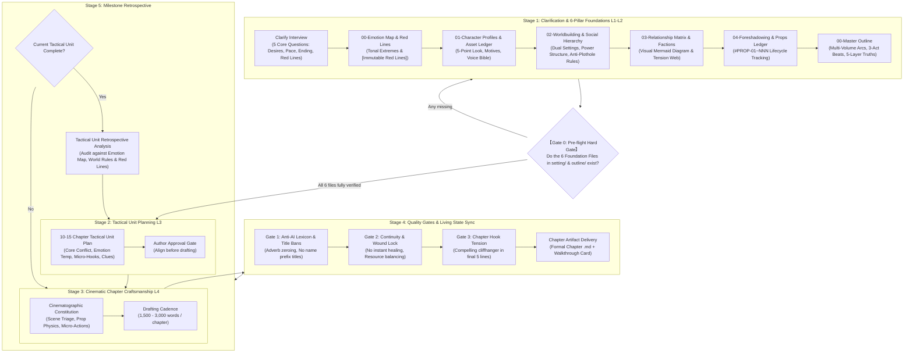

# Commercial Writing System (CWS)

<p align="center">
  <strong>An Industrial-Grade Production Engine for Serialized Novels, High-Tension Fiction & Screenplays with Autonomous AI Agents.</strong>
</p>

<p align="center">
  <a href="README.md">English</a> •
  <a href="README_zh.md">简体中文</a>
</p>

<p align="center">
  
  
  
  
</p>

---

## 📖 The Core Problem: Why Raw LLMs Fail at Long-Form Fiction

When prompted directly to write extended fiction, 99% of Large Language Models (LLMs) break down within 30,000 to 50,000 words. They suffer from the **Four Fatal Flaws of AI Writing**:

| Fatal Symptom | Root Cause | CWS Industrial Solution |
| :--- | :--- | :--- |
| **Floaty & Abstract Prose ("AI Voice")** | Over-reliance on cheap degree adverbs (*extremely, desperately, as if*), tell-don't-show psychology, and repetitive flowery clichés. | **Cinematographic Constitution**: Strict Scene Triage (light/space/micro-climate), tangible prop physics, and micro-action sliced choreography. |
| **Deus Ex Machina & Power Creep** | Zero physical friction. Wounds vanish spontaneously, characters defy fatigue, and solutions fall from the sky. | **Living State Sync & Wound Locks**: Wounds remain physically locked across chapters; inventory, consumables, and travel stamina are strictly balanced. |
| **Amnesia & Dropped Plotlines** | Sliding context windows drop side characters, erase established constraints, and abandon mysteries. | **Numbered Foreshadowing Lifecycle**: All clues strictly indexed (`#001`~`#NNN`) through a 3-state pipeline (*Planted $\rightarrow$ Misdirected $\rightarrow$ Payoff*). |
| **Black-Box Skipping & Pacing Collapse** | Single-shot generation leaps across crucial turning points, flattening dramatic tension into sterile summaries. | **4-Stage Production Pipeline**: Strict 10-chapter tactical units, pre-approved battle plans, single-chapter craftsmanship, and Triple Quality Gates. |

---

## 🏛️ System Architecture & Working Principles

The **Commercial Writing System** deconstructs a master novelist's intuition into a deterministic, verifiable, and anti-collapse industrial engineering pipeline.



---

## 🔬 In-Depth Engineering Mechanisms

### 1. Gate 0: Pre-flight Hard Gate
> **Eradicating LLM's "People-Pleasing Skip Syndrome"**: Vanilla AI assistants often rush to dump out an ungrounded Chapter 1 draft, completely bypassing foundational worldbuilding. CWS v1.2.0 introduces an uncompromising pre-flight gate: when prompted to "start writing" or "generate Chapter 1", the agent **is strictly blocked** from generating prose until it has verified that all 6 Foundation Files exist on disk.

### 2. Stage 1: Clarification & 6-Pillar Foundations
Before any chapter text is written, the system enforces a PRD-style alignment:
- **The Clarify Interview (`/clarify`)**: 5 precise questions covering protagonist core desire, narrative temperature, ending expectations, and non-negotiable boundaries.
- **PRD Specification Tags**:
  - `[Immutable Red Line]`: Non-negotiable rules (e.g., *Protagonist never compromises with abusers, clear consent in romance, strict conservation of combat energy*).
  - `[Needs Clarification]`: Ambiguities to be resolved dynamically.
  - `[Optional Feature]`: Secondary subplots and comic-relief elements.
- **The 6 Mandatory Foundation Files (Zero-Prose Gate)**:
  1. `setting/00-emotion-map.md`: Identifies the All-Is-Lost Moment, Pivot Point, and Climax.
  2. `setting/01-character-profile.md`: Establishes silhouette, facial signatures, tactile garment textures, hand details, and Voice Bible.
  3. `setting/02-worldbuilding-rules.md` (**New in v1.2.0**): Dual spatial metaphors (sanctuary vs. power arena), institutional hierarchy, financial/legal anti-plothole rules.
  4. `setting/03-relationship-matrix-mermaid.md` (**New in v1.2.0**): Visual Mermaid relationship and secret identity network, dynamic tension dimensions.
  5. `setting/04-foreshadowing-props-ledger.md`: Numbered clues with lifecycle states: `Planted` $\rightarrow$ `Misdirected` $\rightarrow$ `Resolved`.
  6. `outline/00-master-outline.md`: Multi-volume strategy and escalating boss hierarchies.

### 2. Stage 2: Tactical Unit Planning (10 Chapters per Sprint)
Long-form marathons collapse without pacing cadence. CWS enforces **10-Chapter Tactical Units**:
- Pre-flight plan detailing each chapter's dramatic beat, emotional temperature (Cold / Tense / Tragic / Explosive), and hook.
- Requires explicit user verification before entering Stage 3.

### 3. Stage 3: Cinematic Chapter Craftsmanship
Writing adheres to the **Cinematographic Constitution**:
1. **Scene Triage (3-Question Rule)**: Every scene transition must answer within the first 3 sentences:
   - *Where does the light come from?* (Direction, color temperature, shadow fragmentation).
   - *What is the acoustic spatial scale?* (Confined stone corridor vs. endless howling desert).
   - *What is in the micro-climate?* (Thermal shock, suspended soot, copper-sweet blood odor).
2. **Prop Physics & Wear**: Props are never abstract nouns. They have weight, balance point, chipping notches, dried blood encrustations, and patina.
3. **Slow-Motion Sliced Choreography**: High-stakes combat or confrontation is dissected frame-by-frame (inertia, bone vibrations, neuromuscular delay).
4. **Physicalized Emotion**: Replaces abstract labels (*"he was terrified"*) with spatial distance adjustments and physiological compensations (*"his jaw clenched until teeth grated, knuckles whitening as fingers dug into rough linen"*).

### 4. Stage 4: Triple Quality Gates & Anti-AI Auditing
Before delivering a chapter, CWS subjects the text to three automated linting gates:
- **Gate 1: Anti-AI Lexicon & Prefix Ban**:
  - **Zero Tolerance Adverbs**: Scans and zeroes out `extremely`, `desperately`, `as if`, `incredibly`, `suddenly`, `unconsciously`.
  - **Ban on Grandiose Title Prefixes**: Forbids tagging character names with decorative titles (e.g., banning *"The Peerless Swordmaster Xu Zheng looked cold"*; requiring *"Xu Zheng looked cold"*). Character status must be proven through action and surrounding reactions.
  - **No Cliché Summaries**: Eradicates false profundities like *"This was not merely a strike, but..."*.
- **Gate 2: Continuity & Wound Lock**:
  - Validates that injuries sustained in prior chapters are not magically healed.
  - Verifies travel resources, mounts, arrows, and physical stain persistence.
- **Gate 3: Hook Tension**:
  - Verifies that the final 5 lines establish high dramatic gravity (countdown, arrival of new adversary, lethal dilemma).
- **Deliverables**: Outputs the formal chapter file along with a `walkthrough_XXX.md` audit card detailing character snapshots, sensory highlights, and foreshadowing updates.

### 5. Stage 5: Unit Retrospective Analysis
Every 10 chapters, the system conducts a comprehensive retrospective against `00-emotion-map.md` and `[Immutable Red Line]` constraints, preventing drift before proceeding to the next unit.

---

## 🎯 Benchmark: Vanilla LLM vs. Commercial Writing System

| Scenario | Vanilla LLM Output (High "AI Voice") | CWS Output (Cinematic & Tangible) |
| :--- | :--- | :--- |
| **Execution Ground Rescue** | *"He was extremely shocked, as if struck by lightning. In the face of cruel enemies, he pulled out his sharp sword without hesitation, his heart burning with immense anger, vowing to save the girl."* | *"A pale sliver of winter daylight slashed down along the guillotine's blue steel edge. The masseter muscle in his jaw twitched violently. His right thumb clicked the hilt spring free—a sharp clink—and three inches of pattern-welded cold steel cleared the scabbard, kicking up a bitter reek of raw iron."* |
| **Fighting While Wounded** | *"Although he was severely wounded, his unyielding willpower allowed him to unleash a devastating technique once again, scattering his terrified foes."* | *"The splint on his left tibia snapped with a sickening crunch of bone fragments grinding against muscle. He did not retreat. Reversing his grip on the fifty-pound horse-cleaver with his remaining sound arm, he rode the horse's downward momentum into a thunderous downward cleave."* |
| **Army Standoff** | *"Both armies were massive and filled with terrifying killing intent. The air was thick with the scent of an impending, devastating war."* | *"Fifty thousand drawn compound bows formed a shimmering field of mirrored steel under the high noon sun. The gorge fell so quiet that the hiss of sand grains pattering onto dried brambles carried across the ranks, punctuated only by battle banners violently whipping in the carrion wind."* |

---

## 📂 Repository Structure

```text
commercial-writing-system/
├── SKILL.md                                # Core Agentic Skill entrypoint
├── README.md                               # English system documentation
├── README_zh.md                            # Complete Chinese system documentation
├── LICENSE                                 # MIT Open Source License
├── references/                             # Foundational specifications & methodology
│   ├── cinematographic-constitution.md     # Lighting vectors, acoustics, prop weight & micro-actions
│   ├── anti-ai-lexicon.md                  # Strict keyword blacklist & humanized replacement guide
│   ├── foreshadowing-tracker-spec.md       # Numbered clue lifecycle & living state audit rules
│   └── genre-playbooks.md                  # Pacing playbooks (Historical power struggle, suspense, short drama)
└── templates/                              # Production scaffolding templates
    ├── 00-emotion-map.md                   # Emotion curves, extreme points & [Immutable Red Lines]
    ├── 01-character-profile.md             # 5-element sensory character profile template
    ├── 02-master-outline.md                # 4-tier outline & 5-layer truth peeling architecture
    ├── 03-unit-plan-10ch.md                # 10-chapter tactical unit pre-flight plan
    └── 04-chapter-walkthrough.md           # Chapter audit & walkthrough review card
```

---

## 🚀 Quick Start

### Option A: Install into Agent Runtimes (Antigravity / Claude Code / Codex / Cursor)

Clone this repository into your runtime's custom skills directory:

```bash
# Antigravity / Gemini CLI default skill path:
cd ~/.gemini/config/skills/
git clone https://github.com/egguy886/commercial-writing-system.git

# Claude Code default tools / skills path:
cd ~/.claude/skills/
git clone https://github.com/egguy886/commercial-writing-system.git
```

Activate the system in your prompt:
> *"Using the **Commercial Writing System**, help me launch a 200-chapter historical power struggle novel. The core premise is..."*

The system will automatically trigger **Stage 1: Clarify Interview** with 5 tailored questions.

### Option B: Manual Integration into Any Writing Workspace

1. In your project workspace, create a `settings/` (or `设定/`) directory.
2. Copy the templates from `templates/` into your `settings/` folder:
   - `00-emotion-map.md`
   - `01-character-profile.md`
   - `02-master-outline.md`
   - `03-foreshadowing-tracker.md`
3. Plan your first 10 chapters using `templates/03-unit-plan-10ch.md`.
4. Instruct your AI agent to strictly enforce `references/cinematographic-constitution.md` and `references/anti-ai-lexicon.md` during chapter drafting.

---

## 📄 License

Distributed under the [MIT License](LICENSE). Open for authors, screenwriters, indie developers, and AI engineers to adapt, expand, and commercialize freely.
