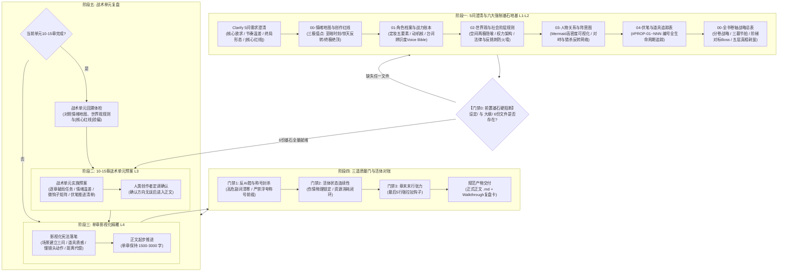

# 商业写作系统 | Commercial Writing System (CWS)

<p align="center">
  <strong>专为中长篇连载小说、高能短剧与爆款网文打造的工业化专业创作引擎</strong>
</p>

<p align="center">
  <a href="README.md">English</a> •
  <a href="README_zh.md">简体中文</a>
</p>

<p align="center">
  
  
  
  
</p>

---

## 📖 核心痛点：为什么原生大模型写不好长篇小说？

直接让大语言模型（LLM）写长篇小说，99% 会在 3~5 万字之内迅速崩坏，陷入 AI 写作的**四大绝症**：

| 绝症症状 | 产生原因 | 商业写作系统（CWS）工业破局方案 |
| :--- | :--- | :--- |
| **悬浮虚假（假大空、AI味浓）** | 充斥“极其、极度、宛如、不禁、不由得”等廉价副词，喜欢贴标签和说明性心理概述，缺乏真实物理感官。 | **影视化写作宪法**：场景建立三问（光影/空间尺度/空气微环境）、关键道具重量与岁月战损、微动作帧级切片。 |
| **机械降神（战力失控、神级自愈）** | 模型缺乏物理约束与因果链，遇到困境强行瞬愈、天降奇兵或爆种。 | **活体状态对账与伤情锁定**：上一章受过的断骨烧伤必须物理锁定几十天；随行干粮、水囊与箭矢严格对账。 |
| **失控烂尾（前写后忘、线索悬空）** | 上下文窗口滑动导致重要配角蒸发、伏笔悬空无着落。 | **伏笔编号生命周期管理**：全书悬念强制编号（`#001`~`#NNN`），经历【已埋设 $\rightarrow$ 推进/误导 $\rightarrow$ 回收兑现】严密闭环。 |
| **黑盒跳步（快餐粗糙、节奏崩塌）** | 一次性指令生成大几千字粗坯，跳过关键冲突积累，情绪曲线扁平。 | **4阶段工业化流水线**：前置5问需求澄清，10章战术单元先行，一章一磨，三道质量门严格卡点。 |

---

## 🏛️ 系统架构与工作原理（Architecture & Workflow）

商业写作系统将顶级职业写手与编剧的创作直觉，解构为一套**确定性、可量化、防崩塌的工业化流水线**：



---

## 🔬 工业级核心机制深度解析

### 1. 门禁 0：前置基石硬阻断门禁（Hard Pre-flight Gate）
> **彻底根除大模型的“讨好型跳步病”**：大模型往往急于向用户交付粗制滥造的正文第 1 章，直接跳过地基阶段。CWS v1.2.0 加入了硬门禁校验机制——当用户提出“开写”、“输出第一章”等指令时，AI **严禁直接写正文**，必须先自主检索工作区中六大基石文件是否完备。缺失任意一份，强制阻断并提示创作者补齐。

### 2. 阶段一：需求澄清与六大强制基石地基（Clarification & 6-Pillar Foundations）
在生成设定和大纲前，杜绝粗暴跳步，严格执行 PRD 规格对齐：
- **交互式 5 问澄清（Clarify Interview）**：围绕核心驱动力（复仇/生存/解密/守护）、叙事温差、终局取向与创作红线展开精准提问。
- **PRD 规格与红线标记**：
  - `[核心红线]`：不可妥协的底线（如：主角绝不圣母、亲密戏必须明确同意 Clear Consent、战力数值严格守恒）。
  - `[需要澄清]`：待后续推进中敲定的开放性决策。
  - `[可选特性]`：锦上添花的情节点或轻喜剧调节支线。
- **六大基石资产（缺一不可动笔）**：
  1. `设定/00-情绪地图与创作红线.md`：绘制全书心流曲线，锚定至暗时刻（50%~60%）、惊天反转（65%~75%）、终极绝顶（90%~95%）。
  2. `设定/01-角色档案与战力账本.md`：立足定妆五要素（体型轮廓、面部特征、服装材质、手部细节、压迫气场）、动机核心与台词辨识度（Voice Bible）。
  3. `设定/02-世界观与社会阶层规则.md`（**v1.2.0 新增**）：空间两极隐喻（原生避风港 vs 权力名利场）、组织阶层架构、经济/法律/战力兑换比反挑刺防火墙（Anti-Plothole）。
  4. `设定/03-人物关系与阵营图.md`（**v1.2.0 新增**）：高信息密度 Mermaid 关系图、对峙维度、隐藏马甲网络、双向猎杀反转链。
  5. `设定/04-伏笔与道具生命周期追踪表.md`：编号线索与信物生命周期（`#PROP-01`~`#PROP-NNN`，埋设 $\rightarrow$ 递进/误导 $\rightarrow$ 回收兑现）。
  6. `大纲/00-全书卷轴战略总表.md`：分卷战略目标与五层真相递进（表象事实 $\rightarrow$ 伪动机 $\rightarrow$ 组织阴谋 $\rightarrow$ 历史原罪 $\rightarrow$ 核心人性真相）。

### 2. 阶段二：战术作战单元（10-Chapter Tactical Unit）
避免“盲目长跑导致中途塌陷”。以 **10 章为一个敏捷作战单元**：
- 提前输出 10 章实施预案，明确逐章事件推进、情绪温差（冷/燃/虐/悬）、章末钩子与待推进伏笔。
- 必须经过人类创作者确认后，方可启动本单元的逐章撰写。

### 3. 阶段三：单章影视化精雕（Cinematic Craftsmanship）
严格遵循《影视化写作宪法》：
1. **场景建立三问（Scene Triage）**：场景切换或新幕拉开，前三句内必须完成视听建模：
   - *光从哪里来？*（冷暖光性、入射角度、明暗切割）。
   - *空间尺度有多大？*（逼仄密室与回声声学、浩渺风沙荒原）。
   - *微环境里有什么？*（温差与哈气、漂浮尘埃、血腥氧化铁锈味、木料焦糊味）。
2. **重要道具质感与战损**：拒绝塑料感。生铁的冷脆、玄铁的沉重、玉石的糯性与断口晶体；卷刃崩口与油脂包浆。
3. **动作慢镜头切片**：刀锋切入铠甲的受力形变、手腕震麻、受击后神经失真与痛感延迟等生理代偿。
4. **情感物理化呈现**：严禁“他极度愤怒/她十分悲伤”。必须转化为两人物理间距的退缩、下唇咬穿、手指攥紧发白与呼吸节律骤乱。

### 4. 阶段四：三道质量门与反 AI 审查（Quality Gates）
每章生成完毕，必须通过三道严苛门禁方可交付：
- **门禁 1：反 AI 腔与词汇过滤器（Anti-AI Gate）**：
  - **副词清零**：严厉排查并清零 `极其`、`极度`、`简直`、`宛如`、`仿佛`、`毫无疑问`、`分外` 等通胀副词。
  - **绝对封杀浮夸称号人名前缀**：严禁在名字前堆砌称号（如“*天下第一剑修许正*”、“*北境狼王元野*”、“*绝世神医林辰*”）。直接称呼姓名，靠行动与他人反应彰显威慑。
  - **结构性去油**：彻底铲除“不仅……更是……”、“眼神闪过一丝……”、“嘴角勾起一抹……”等网文套话。
- **门禁 2：活体状态连续性检查（Continuity Gate）**：
  - 伤情物理锁定（骨折、烧伤严禁跨章“神级瞬愈”）。
  - 资源对账（干粮、水袋、箭矢、马匹、银两消耗实打实闭环）。
- **门禁 3：章末钩子张力（Hook Gate）**：
  - 最后 5 行必须具备强张力（新危机逼近、倒计时滴答、核心秘密漏缝、生死抉择）。
- **交付产物**：正式正文文件 + `walkthrough_XXX.md`（复盘卡，记录高光切片、伤情物资变动与下章预告）。

### 5. 阶段五：战术单元复盘与体检（Unit Retrospective）
每 10 章完成后，系统自动对照 `00-情绪地图.md` 与 `[核心红线]` 进行偏离度回溯，确保长篇连载不走样、不崩盘。

---

## 🎯 效果对比：原生 AI vs 商业写作系统

| 场景 | 原生大模型直接生成（AI腔拉满） | 商业写作系统驱动（影视级质感） |
| :--- | :--- | :--- |
| **刑场救人** | “他心中极度震惊，宛如晴天霹雳。面对凶恶的敌人，他毫不犹豫地拔出了锋利的宝剑，心中充满了滔天的愤怒，誓要拯救眼前的女子。” | “一缕惨白的日光顺着闸刀的青刃斜劈下来。他下颌咬肌猛地一突，右手拇指顶开簧锁，‘铮’的一声脆响，百炼折叠锻打的花纹钢出鞘三寸，激起一股冰冷的铁腥。” |
| **伤后战斗** | “虽然他身负重伤，但他凭借顽强的意志力，再次施展出排山倒海的绝招，杀得敌人落荒而逃。” | “他左腿夹板崩断，断骨在肌肉里发出令人牙酸的摩擦声。他没有后退，右臂单手倒提百斤斩马刀，借着战马俯冲的惯性，自上而下一记暴烈的硬砸！” |
| **两军对峙** | “两支大军阵容浩大，杀气腾腾，战争一触即发。” | “五万张强弓硬弩在阳光下汇成一片反光的银色海洋。四下静得连黄沙落在枯叶上的沙沙声都听得一清二楚，只有战旗在腥风里被抽打得啪啪作响。” |

---

## 📂 仓库目录结构

```text
commercial-writing-system/
├── SKILL.md                                # 核心技能入口（遵循 Agentic Skill 规范）
├── README.md                               # 英文官方文档
├── README_zh.md                            # 完整中文系统文档
├── LICENSE                                 # MIT 开源协议
├── references/                             # 核心方法论与权威规范
│   ├── cinematographic-constitution.md     # 影视化写作宪法（场景三问、道具质感、慢动作切片）
│   ├── anti-ai-lexicon.md                  # 反AI腔词汇黑名单与置换指南（含称号前缀禁令）
│   ├── foreshadowing-tracker-spec.md       # 伏笔生命周期模型与活体状态追踪对账
│   └── genre-playbooks.md                  # 主流赛道节拍手册（历史权谋/悬疑/微短剧/知乎反转）
└── templates/                              # 开书工程脚手架模板
    ├── 00-emotion-map.md                   # 情绪地图模板（含 [核心红线] 规格说明）
    ├── 01-character-profile.md             # 活体角色档案表模板（定妆五要素）
    ├── 02-master-outline.md                # 四级骨架大纲模板（含五层真相剥茧法）
    ├── 03-unit-plan-10ch.md                # 10章单元战术实施预案模板
    └── 04-chapter-walkthrough.md           # 单章复盘与交付卡模板
```

---

## 🚀 快速上手（Quick Start）

### 方式一：在 Antigravity / Claude Code / Codex / Cursor 中安装

将本项目克隆至 Agent 对应的自定义 Skill 路径中：

```bash
# Antigravity / Gemini CLI 默认技能路径：
cd ~/.gemini/config/skills/
git clone https://github.com/egguy886/commercial-writing-system.git

# Claude Code 技能路径：
cd ~/.claude/skills/
git clone https://github.com/egguy886/commercial-writing-system.git
```

在对话中直接发送指令唤醒：
> “使用**商业写作系统**，帮我开一本200章的历史权谋小说，核心设定是……”

系统将自动触发**阶段一：Clarify 5 问澄清**，与你开始共创。

### 方式二：手动集成到任意小说工作区

1. 在你的小说项目根目录下，新建 `设定/` 文件夹。
2. 将 `templates/` 下的文件复制到 `设定/` 中作为开书基盘：
   - `设定/00-情绪地图.md`
   - `设定/01-角色档案.md`
   - `设定/02-大纲.md`
   - `设定/03-伏笔追踪表.md`
3. 按照 `templates/03-unit-plan-10ch.md` 规划第一个 10 章作战单元。
4. 正文生成时，要求 AI 严格加载并遵守 `references/cinematographic-constitution.md` 与 `references/anti-ai-lexicon.md`。

---

## 📄 开源许可证

本项目基于 [MIT License](LICENSE) 开源。欢迎所有网络作家、编剧、独立游戏开发者及 AI 创作者自由使用、魔改与分发。
