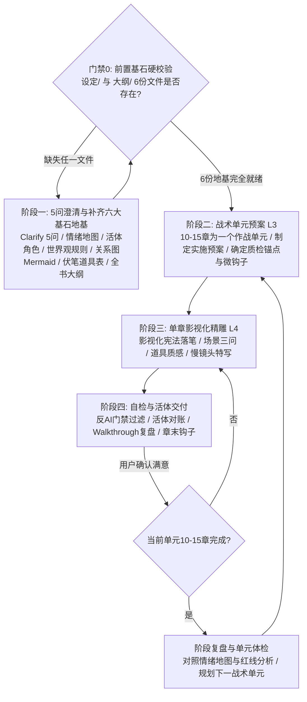

# 商业写作系统 | Commercial Writing System (v1.2.0)

> **系统宣言**
> 好的商业小说不是词藻的堆叠，而是**精准的情绪操纵、严密的因果链条与沉浸的视听质感**。
> 本系统拒绝“快餐式批量灌水”，严厉封杀“失控黑盒跳步”，坚持**“六大基石定调、硬门禁拦截、预案先行、一章一磨、活体对账”**的工业级流水线。

---

## 核心工作流总览（The 5-Stage Production Pipeline）

---

## 门禁 0：前置基石硬阻断门禁（Hard Pre-flight Gate）

> [!CAUTION]
> **严禁大模型“讨好型跳步”！**
> 当创作者提出“写第一章”、“开始创作”、“发了原著大纲”等指令时，AI **严禁直接生成正文粗坯**！
> AI 必须先自主检索工作区中是否已完整生成并落盘了**六大基石文件**。若缺少任何一份，必须强制阻断，引导创作者先对齐地基文件！

---

## 阶段一：需求澄清与六大强制基石地基（Clarification & 6-Pillar Foundations）

动笔前必须执行 **需求澄清**，并在项目工作区严格落盘以下六份核心基石资产：

### 0. 交互式 5 问澄清（Clarify Interview）
在生成基石大纲前，AI 必须向人类创作者抛出 3~5 个精准定向问题，彻底击碎模糊点：
1. **核心驱动力**：主角的最底层欲望是复仇、夺权、生存、解密还是守护？
2. **节奏与温差**：期望是紧凑高压的快节奏爽剧，还是张弛有度的厚重慢热？
3. **创作红线**：有哪些绝对不可触碰的毒点或底线？（打上 `[核心红线]` 标签，如“主角绝不圣母、亲密戏必须明确同意Clear Consent”）
4. **终局形态**：结局倾向大团圆、深意留白还是惨烈余韵？
5. **规格标记支持**：在后续所有设定中严格使用 `[核心红线]`（不可妥协）、`[需要澄清]`（待定暂存）、`[可选特性]`（锦上添花）。

### 1. 建立六份强制基石文件（缺一不可动笔）：

#### 📁 `设定/` 目录下（实体设定集）：
1. **`00-情绪地图与创作红线.md`**：
   - 标注不可违背的 `[核心红线]` 规约。
   - 标注全书三大情绪极值点（至暗时刻、惊天反转、最终绝顶）。
2. **`01-角色活体档案与战力资产账本.md`**：
   - **首次定妆五要素**：体型轮廓、面部标志（一道疤/深眸/骨节）、服装触感与质地、手部特征（老茧/伤痕/扳指）、压迫气场。
   - **角色动机核**：绝不可动摇的核心欲望、绝不可触碰之逆鳞。
   - **台词辨识度（Voice Bible）**：语速、句式偏好、标志性口吻。
3. **`02-世界观与社会阶层规则.md`（新增强制）**：
   - **双重地理舞台与空间隐喻**：原生避风港 vs 权力名利场（感官微环境对比）。
   - **组织架构与权力阶层**：顶级垄断集团 vs 次级竞争势力 vs 底层中立群体。
   - **经济、法律与反挑刺防火墙（Anti-Plothole）**：大额资金合规路径、刑法规则、阶层真实阻力。
4. **`03-人物关系与阵营图.md`（新增强制）**：
   - **高信息密度 Mermaid 关系图**：明线关系、暗线秘密、伪装马甲、敌对张力。
   - **核心博弈三大维度**：主角 vs 核心对手（猎杀反转）、主角 vs 宿敌前任（降维打击）。
5. **`04-伏笔与道具生命周期追踪表.md`**：
   - 所有重大道具、信物、身体印记、核心款项严格编号（`PROP-01` ~ `PROP-NNN`）。
   - 状态追踪：【已埋设】 $\rightarrow$ 【推进/误导】 $\rightarrow$ 【回收兑现】。任何伏笔严禁无故悬空。

#### 📁 `大纲/` 目录下（节拍与预案）：
6. **`00-全书卷轴战略总表.md`**：
   - 卷级划分（通常4-8卷），严格对标三幕式结构。
   - 每卷明确：**战略目标**、**对标对手/阶段阻力**、**卷末核弹级大钩子**、**核心真相递进层级**。
7. **`01-战术单元预案.md`**（每 10-15 章一份，滚动生成）：
   - 单元逐章关键事件、情绪温差（冷/燃/虐/悬）、章末钩子（Cliffhanger）。
   - 本单元需推进或回收的伏笔编号清单。

---

## 阶段二：战术单元预案（10-Chapter Tactical Unit）

为保证长篇连载的节奏密度，严禁一次性无序长跑，必须以 **10章为一个战术作战单元** 推进：

- **单元启动前**：输出一份《第XX-XX章单元实施预案》：
  - 本单元的破局核心任务与矛盾爆发点。
  - 10章逐章关键事件、情绪温差（冷/燃/虐/悬）、章末钩子。
  - 需推进或回收的伏笔编号清单。
- **用户确认**：由创作者/人类监督者确认预案方向无误后，再行进入逐章撰写。

---

## 阶段三：单章影视化精雕（Chapter-by-Chapter Craftsmanship）

坚持**“一章一写，质量保证”**原则，单章正文字数通常保持在 **1500~3000字** 之间。

### 0. 动笔前强制预检：写前三读（The Pre-Drafting Triple-Read）
> [!IMPORTANT]
> **严禁盲目凭空开篇！** 撰写第 N 章正文前，AI 必须严格执行前置“三读”，打通上下文血脉：
> 1. **读 1：承接上一章（Continuity Read）**：
>    - 必须读取第 N-1 章的**尾声文本（最后 300~500 字）**与 `walkthrough_XXX.md`（活体状态快照）。
>    - 锁定上一秒的时间线切片、物理地点、主角伤情/物资、未散尽的微表情与情绪余波。严禁出现跨章情绪或场景断崖。
> 2. **读 2：对标本章细纲（Tactical Plan Read）**：
>    - 必须读取当前战术单元预案中对应本章的**细纲条目**。
>    - 锁定本章核心破局任务、情绪温差（冷/燃/虐/悬）、必须推进/回收的伏笔编号、章末必留的强张力钩子（Cliffhanger）。
> 3. **读 3：俯瞰宏观卷轴与红线（Macro Alignment）**：
>    - 对照 `00-全书卷轴战略总表.md` 与 `00-情绪地图与创作红线.md`。
>    - 确保本章局部冲突服从全书大节拍，严格防范踩踏 `[核心红线]` 或出现人设崩塌。

---

### 导演机位调度三问（Director Camera Protocol）
在敲下第一个字前，作者脑海中必须完成三维视听分镜定焦：
1. **摄影机机位（POV Anchor）**：
   - 本场戏的主镜头死死焊在谁的视点上？
   - 感官半径（目力所及、耳畔分贝、皮肤温感）锁定在几米之内？严禁无预兆越轴（Crossing the Line）与全知上帝视角解说。
2. **物理站位与身体距离（Blocking & Proxemics）**：
   - 开场时两人的物理间距是几米？（隔着一张会议桌、两米防备身位、还是鼻尖相距三寸？）
   - 在对话与冲突推进中，是谁在主动迫近施压？是谁在受迫后撤？**物理距离的每一次拉近或拉远，就是权力与心理防线的争夺战。**
3. **台词潜台词层（Subtext Layer）**：
   - 表面对话（Text）在聊什么？（如：“今晚风挺大。”）
   - 冰山之下的真实欲望与博弈潜台词（Subtext）是什么？（如：“我知道你认出我了，但我赌你不敢在这里动手。”）
   - 严禁“所想即所说”的扁平白痴对话。

---

### 1. 场景建立三问（Scene Triage）
每次场景转换或新开一幕，前3句内必须回答：
- **光从哪里来？**（冷暖、照射角、光斑穿透度、被阴影切割的明暗面）
- **空间尺度有多大？**（是狭窄窒息的密闭暗窟，还是回声浩渺的风沙峡谷）
- **空气微环境有什么？**（温差骤变、悬浮粉尘、血腥/土腥/焦木气味、耳边风声）

### 2. 重要道具质感（Prop Weight & Texture）
关键道具（兵刃、信物、令牌、文书、毒药）出场必须具备：
- **材质与重量感**：生铁的冷脆、玄铁的沉重、玉石的温润与断口晶体颗粒。
- **岁月战损痕迹**：磨损豁口、血锈斑驳、油脂包浆，拒绝全新塑料感。

### 3. 动作慢镜头切片（Micro-Action Choreography）
战斗、行刑、刺杀或高潮对峙，必须包含**帧级微动作描写**：
- 刀锋与骨骼/铠甲接触时的物理力道传导（震麻手腕、崩碎刃角）。
- 角色生理微反应（瞳孔骤缩、倒吸凉气、肌肉抽搐、后牙咬穿）。

### 4. 情感物理化表达（Physicalized Emotion）
- **严禁使用抽象情绪词**（禁止：“他极度愤怒/她伤心欲绝/内心十分震惊”）。
- **必须转化为物理距离与身体代偿**：两人的物理间距变化、手指攥紧指节发白、呼吸节律被打乱、下意识向后撤出防备身位。

---

## 阶段四：自检与状态对账（Quality Gates & State Sync）

单章正文完成后，必须在交付前执行**三道质量门（Quality Gates）**：

### 门禁1：反AI腔与词汇过滤器（Anti-AI Gate）
- [ ] **高频违禁副词清零**：全文扫描严查“极其、极度、宛如、简直、仿佛、赫然、不禁、不由得”。若出现，必须改用具象白描动词替换。
- [ ] **绝对封杀浮夸称号前缀**：提到角色直接称呼名字，严禁在人名前加长串称号或定语（如“天下第一剑修许正”、“北境狼王元野”、“冷酷摄政王楚墨”）。靠角色的动作与他人反应立威，不贴金。
- [ ] **说明性总结清理**：禁止在文末使用“这不仅是……更是……”这类AI公文式概括。
- [ ] **视角连贯**：严禁无预兆上帝视角切换，牢牢锁定当前视点角色的感官半径。

### 门禁2：活体状态连续性检查（Continuity Gate）
- [ ] **伤情物理锁定**：检查上一章受过的伤（断骨、烧伤、失血）本章是否被遗忘或“神级自愈”。
- [ ] **资源对账**：随行人数、干粮、水袋、箭矢数量是否与上文闭环对齐。
- [ ] **环境印记**：身上的泥浆、血渍、破烂衣物是否随物理移动保持合理状态。

### 门禁3：章末钩子张力（Hook Gate）
- [ ] 结尾最后5行必须具备强张力（新敌人现身、致命倒计时、惊天秘密漏缝、生死抉择点），绝不平淡收场。

### 单元闭环验收（每 10-15 章阶段复盘）：
每完成一个战术作战单元，执行一次**框架与质量体检（Unit Retrospective）**：
- 对照 `设定/00-情绪地图与创作红线.md`：检查情绪温差是否达标，主线是否跑偏。
- 对照 `[核心红线]`：核对角色行为与设定是否违规。
- 对照 `设定/02-世界观与社会阶层规则.md`：核查经济、法律与阶层规则是否被破坏。
- 对照 `设定/04-伏笔与道具生命周期追踪表.md`：核查本单元伏笔埋设与回收情况，确认无误后再开启下一单元。

### 交付产物规范：
1. **正文文件**：存入 `正文/第XXX章-XXX(正式版).md`。
2. **复盘卡**：同步生成 `walkthrough_XXX.md`，向创作者汇报：
   - 核心剧情动作与反转点
   - 影视化高光镜头切片
   - 角色活体状态快照（伤情/物资更新）
   - 下章悬念钩子预告
3. **看板更新**：实时刷新 `task.md` 进度。

---

## 附录与支撑资产（References & Templates）

- 完整影视化规范详见：`references/cinematographic-constitution.md`
- 反AI词汇与句式禁令详见：`references/anti-ai-lexicon.md`
- 伏笔与状态快照管理规范详见：`references/foreshadowing-tracker-spec.md`
- 各题材平台（男频/女频/短剧/悬疑）适配手册详见：`references/genre-playbooks.md`
- 全套开书脚手架模板详见：`templates/`
