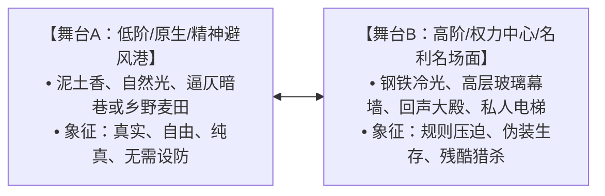

# 《【书名】》世界观与社会阶层规则

> **世界观设计铁律**
> 好的世界观不是百科全书式的堆砌，而是**阶层矛盾的物理化映射、生存资源的分配博弈与无懈可击的运行规则**。
> 严禁出现无法自圆其说的经济、法律与力量漏洞，所有设定必须为剧情冲突服务。

---

## 一、双重地理舞台与空间隐喻（Spatial Metaphors）

本书通过两极化的物理空间与感官符号，具象化阶层鸿沟与主角的心境蜕变：

### 1. 核心舞台 A（原生/底层坐标）
* **地理位置与风貌**：
* **感官微环境**（气味/温度/材质）：
* **角色在此的心理状态**：

### 2. 核心舞台 B（权力/名利场坐标）
* **地理位置与建筑形制**：
* **感官微环境**（光线照射角度/空间压迫感）：
* **阶层准入门槛与规则**：

---

## 二、组织架构与权力阵营（Power Hierarchy）

### 1. 顶层垄断集团 / 皇权势力（Faction Alpha）
* **势力名称**：
* **掌控的核心命脉**（商业资本/军权/稀缺矿石/灵脉/官职）：
* **领袖与核心代理人**：
* **处事法则与暗黑底色**：

### 2. 次级竞争势力 / 挑战者（Faction Beta）
* **势力名称**：
* **生存策略与依附关系**：
* **主要矛盾点**：

### 3. 底层中立群体 / 夹缝生存者（The Civilians / Neutrals）
* **生存常态与被盘剥机制**：

---

## 三、经济、法律与合规防火墙（Economic & Anti-Plothole Rules）

> [!IMPORTANT]
> 杜绝逻辑漏洞（Anti-Plothole）：必须提前封死读者可能会在评论区挑刺的现实常识、金融合规、律法刑名或战力兑换比漏洞！

1. **货币与资源兑换恒定比**：
   - 【例】大额资金流动的合规化路径（如：设立独立信托托管账户、以海外离岸基金隔离、避免触发反洗钱风控审查）。
2. **制度与法律铁律（不可违抗的硬约束）**：
   - 【例】皇城宵禁三更动刀必诛九族 / 现代社会明确口头同意（Clear Consent）与反欺诈边界。
3. **阶层流动的真实阻力**：
   - 严禁“草根随随便便见皇帝/小职员随手掌掴千亿总裁”的悬浮网文套路，每一次跨越阶层必须支付惨痛代价或持有致命底牌。
